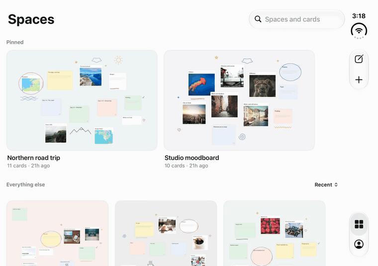
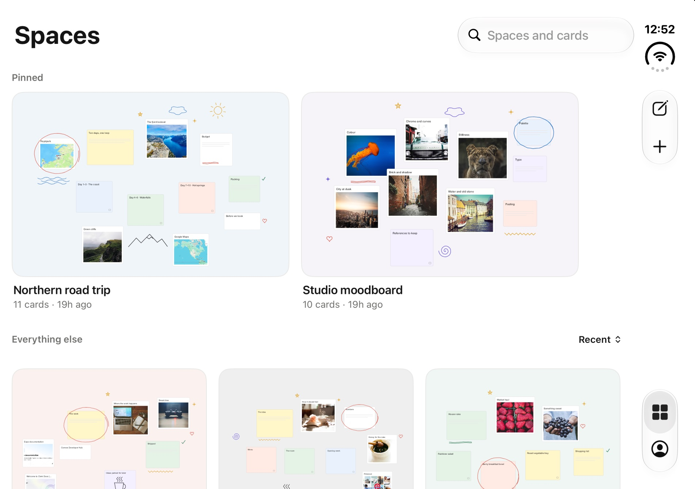
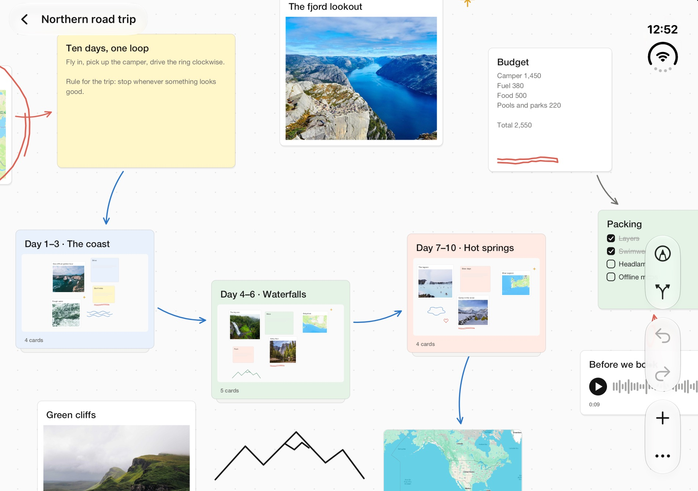
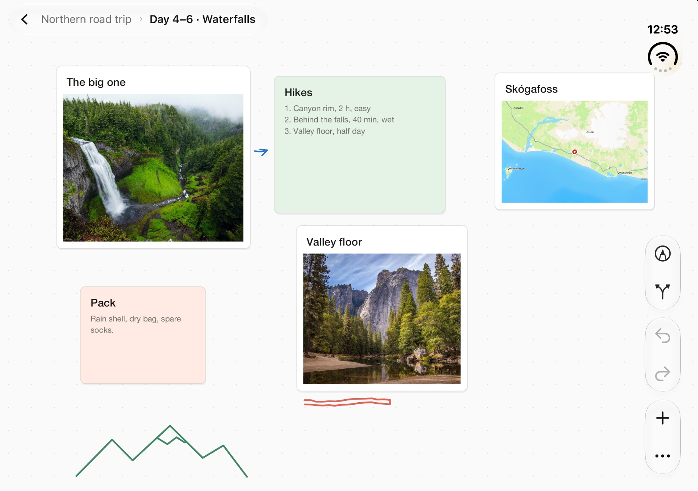
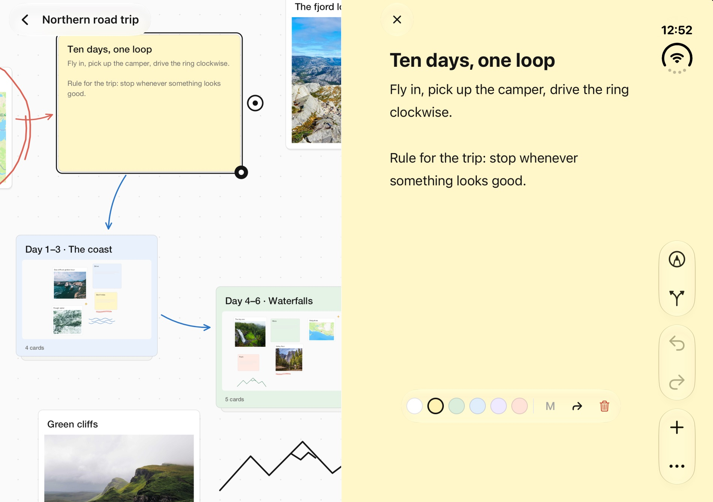
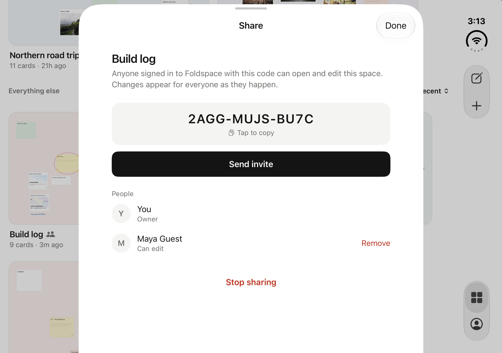
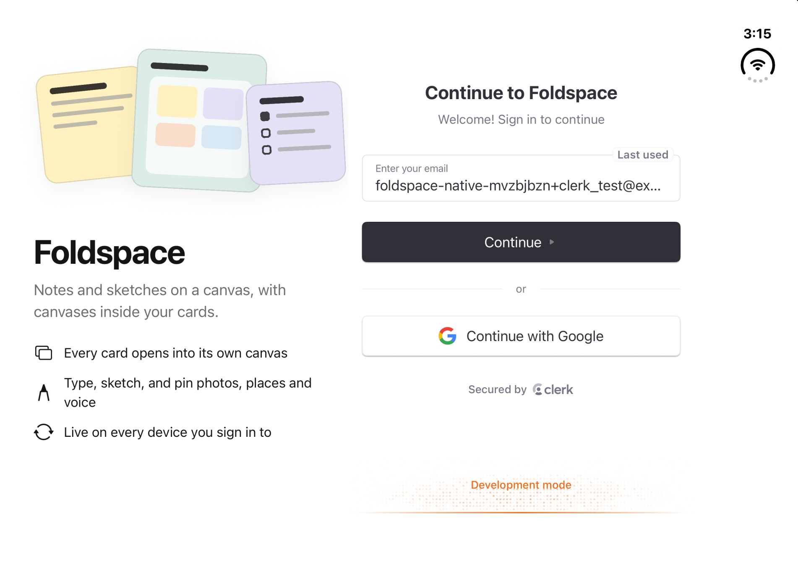
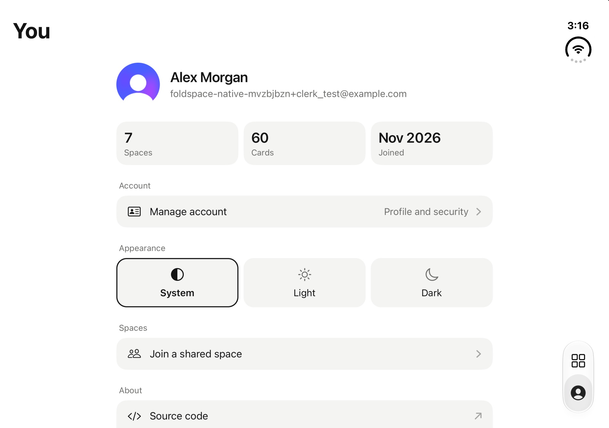
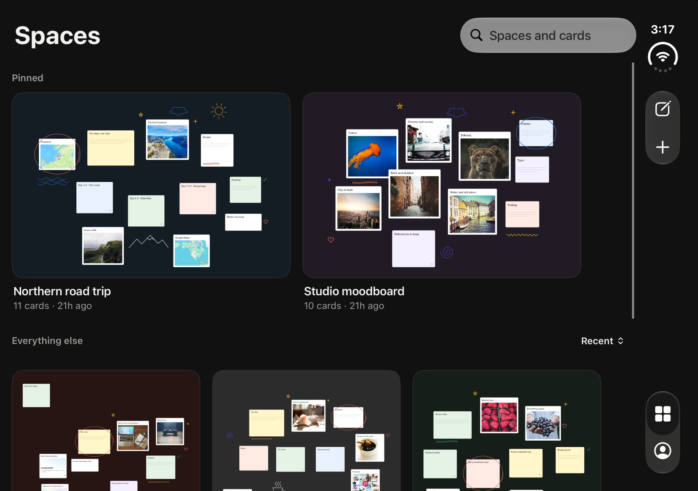
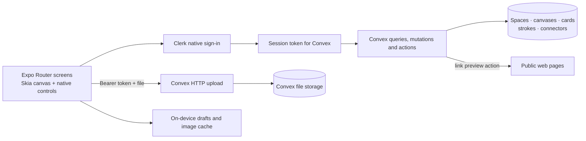

# Foldspace — A Fold-Aware Visual Notebook for iPhone & iPhone Duo with Expo, Clerk & Convex

[](https://try.expo.dev/sonny)
[](https://try.expo.dev/sonny)
[](https://go.clerk.com/sonny)
[](https://www.convex.dev/)
[](https://reactnative.dev/)
[](https://react.dev/)
[](https://shopify.github.io/react-native-skia/)
[](https://www.typescriptlang.org/)

**Ideas that open into more ideas.** Foldspace is an infinite canvas for sticky notes, photos, checklists, voice notes, map pins, links and ink. Any card can be a **space** you step into, and that space has a canvas of its own. On iPhone Duo, unfold the phone and the canvas sits beside the note you are writing.

It is a real, signed-in, realtime app you can share with other people: **native Clerk authentication, a Convex backend, a Skia canvas driven by Reanimated and Gesture Handler, and native iOS navigation, menus and Liquid Glass** from Expo SDK 58.

[**Get started with Expo →**](https://try.expo.dev/sonny) · [**Get started with Clerk →**](https://go.clerk.com/sonny) · [**Join the free AI Community →**](https://www.papareact.com/ztoh-form)



> **Who is this for?** Developers who want to see what a native-feeling Expo app looks like beyond a list and a form: a gesture-heavy canvas, a fold-aware layout, native authentication, and a backend where every read and write is checked against the signed-in user.

> **No Mac? No problem.** You can run this app on a cloud iPhone with **[EAS Simulator](https://try.expo.dev/sonny)** and watch it in your browser. See [Set up your phone](#set-up-your-phone).

**This build uses:** Expo SDK **58**, React Native **0.88.1**, React **19.3**, Expo Router **58**, Expo UI **58**, Clerk Expo **4.14** with native components **0.4**, Convex **1.49**, React Native Skia **2.14**, Reanimated **4.7**, Gesture Handler **3.3**, TypeScript **6** and Node **24**. Exact resolutions are in [`package-lock.json`](package-lock.json).

---

## 👇🏼 DO THIS Before You Get Started

1️⃣ Sign up to Expo 👉 **[https://try.expo.dev/sonny](https://try.expo.dev/sonny)**

2️⃣ Sign up to Clerk 👉 **[https://go.clerk.com/sonny](https://go.clerk.com/sonny)**

3️⃣ Join my new AI Community for FREE! 👉 **[https://www.papareact.com/ztoh-form](https://www.papareact.com/ztoh-form)**

| Service | Its job in Foldspace | Needed for |
| --- | --- | --- |
| **Expo / EAS** | Builds the app in the cloud and runs it on a cloud iPhone with EAS Simulator | Building and running the app, with or without a Mac |
| **Clerk** | Native sign-in, sessions and the account screen | Authentication |
| **Convex** | Database, file storage, realtime queries and search | Spaces, cards, ink, photos and voice notes |

The Expo and Clerk links above are Sonny's campaign links. You also need a free [Convex](https://www.convex.dev/) account. Create your own accounts and keys when running your copy; none are included in this repository.

## 🧭 Inside This README

- [Features and screenshots](#features)
- [Architecture](#architecture)
- [How the canvas works](#canvas)
- [Authentication and ownership](#auth)
- [Data model and routes](#data-and-routes)
- [Getting started](#getting-started)
- [Set up your phone](#set-up-your-phone)
- [Load the demo spaces](#demo-data)
- [Demo walkthrough](#demo-walkthrough)
- [Testing and verification](#verification)
- [Troubleshooting](#troubleshooting)
- [Take it further](#take-it-further)
- [Quick reference](#quick-reference)

---

<a id="features"></a>

## ✨ Features and Screenshots

### A library you can read at a glance



- Every space shows a live preview of its canvas, including the photos on it.
- Pin the spaces you use most; they get their own row at the top.
- Each space shows how many cards it holds and when it was last edited.
- Search from the library finds space names **and** the cards inside every space.
- The pencil button drops a new note into your most recent space, ready to type.
- Hold a space for Edit, Pin, Share, Search cards and Delete. Delete is immediate and can be undone.

### An infinite canvas with seven kinds of card



| Card | What it holds |
| --- | --- |
| **Note** | A title and a description on coloured paper, typed right on the canvas |
| **Space** | A card you step into; it has a whole canvas inside |
| **Checklist** | Items you tick straight from the canvas |
| **Photo** | An image from your library, with a caption |
| **Voice note** | A recording with a waveform; play it from its card |
| **Place** | A searched location with its map |
| **Link** | A web address with the page's title and picture |

Draw over anything with the pen, erase strokes, and connect two cards with a line that follows them when they move. Undo and redo cover cards, ink and connectors.

### Spaces inside spaces

Tap a space and the system zoom carries you into it. Pinch out quickly to step back up a level. A breadcrumb shows where you are.



### Built for the fold

On an unfolded iPhone Duo the canvas and the editor sit side by side, using the native `ArrangementView`. Fold the phone and the same screen becomes a single canvas; tap a note and you type on it where it sits. Half-folded, the canvas stays a canvas.



### Share a space and work in it together

Open **Share** on a space to create an invite code. Anyone signed in who enters the code can open and edit that space, and every change shows up for everyone as it happens, because each canvas is a live Convex query. The owner sees who has joined, can remove a person, and can stop sharing, which ends everyone's access and retires the code.



People you share with can add, edit and draw. Only the owner can rename, pin, delete or share the space.

### A sign-in screen that looks like the app

Clerk's native sign-in view does the authentication. Foldspace puts its own introduction beside it on a wide screen, and above it on a phone.



### A "You" tab, with light and dark

The **You** tab shows your name and photo from Clerk, how much you have made, and a row that opens Clerk's native account screen for your profile and security settings. Appearance follows the system, or you can pick Light or Dark. Sign out is at the bottom.



In dark mode the app's chrome goes dark and your cards keep the paper colours you gave them.



The screenshots are real application screens captured from an iPhone Duo simulator running the seeded demo spaces.

---

<a id="architecture"></a>

## 🔄 Architecture



| Layer | What it does | Where |
| --- | --- | --- |
| **Navigation** | Native stacks, tabs, toolbars, menus, search and the zoom transition | [`src/app`](src/app), [`src/screens`](src/screens) |
| **Canvas** | Skia drawing, Reanimated shared values, Gesture Handler gestures | [`src/components/canvas`](src/components/canvas) |
| **Fold layout** | Splits canvas and editor when the phone is open | [`src/components/native/duo-layout.ios.tsx`](src/components/native/duo-layout.ios.tsx) |
| **Auth** | Clerk's native sign-in view and account screen, inside the app's own welcome and You screens | [`src/components/auth`](src/components/auth), [`src/screens/you-screen.tsx`](src/screens/you-screen.tsx) |
| **Backend** | Typed queries and mutations, each checked against the caller | [`convex`](convex) |

There is no AI model in this app, and no server of your own to run. Convex is the whole backend.

---

<a id="canvas"></a>

## 🎨 How the Canvas Works

### One drawing, many gestures

The canvas is a single Skia drawing. Card positions, the camera and the in-progress stroke live in Reanimated shared values, so dragging and pinching never wait on React. A change is sent to Convex when the gesture ends, and the on-screen copy is held until the saved one arrives, which is why nothing flickers when you let go.

| Gesture | What it does |
| --- | --- |
| Tap a card | Select it; tap a note again to type on it |
| Tap a space | Zoom into its canvas |
| Double-tap empty canvas | Add a note under your finger |
| Drag a card | Move it |
| Hold a card | Open its menu |
| Drag the dot on a selected card | Connect it to another card |
| Drag the corner of a selected card | Resize it |
| Pinch | Zoom the canvas |
| Pinch out quickly | Step up to the parent space |
| Two-finger drag | Pan |
| Pen on | One finger draws; the eraser removes strokes |

### Every card has a canvas

Creating any card also creates a child canvas. A space is simply a card that shows that canvas. Nesting goes twelve levels deep, and every read walks back up to the root to confirm that the space still exists and is yours.

### Bounds

An account holds up to 100 spaces. A space can be shared with up to 20 people. A canvas holds up to 200 cards and 500 ink strokes. These are limits chosen by this app in [`convex/model/auth.ts`](convex/model/auth.ts), not Convex limits.

---

<a id="auth"></a>

## 🔐 Authentication and Ownership

- **Clerk renders the sign-in screen natively.** [`@clerk/expo-native-components`](https://clerk.com/docs/reference/expo/native-components/overview) provides the SwiftUI sign-in and account views. This is why the app needs a development build and cannot run in Expo Go.
- **Convex verifies every request.** `ConvexProviderWithClerk` passes Clerk's token to Convex, and [`convex/auth.config.ts`](convex/auth.config.ts) accepts it only from your Clerk issuer.
- **The owner is never sent by the client.** Each function reads the identity from the verified token. A guessed ID for a space, card or file you have no access to returns "unavailable".
- **Access is the owner or a member.** [`requireWorkspace`](convex/model/auth.ts) lets in the space's owner and the people who joined it; `requireOwner` guards renaming, pinning, deleting and sharing.
- **Invite codes are hard to guess and guesses are counted.** A code is 12 random characters, shown only to the owner. Eight wrong codes lock an account out of joining for 15 minutes. See [`convex/sharing.ts`](convex/sharing.ts).
- **Uploads are checked twice.** Photos and voice notes go through an authenticated HTTP route in [`convex/http.ts`](convex/http.ts) that checks access to the space, the file type and the file size.
- **Link previews are fetched on the server** by [`convex/links.ts`](convex/links.ts), which refuses private and local network addresses and follows redirects one checked hop at a time.

Only the Clerk **publishable** key is bundled into the app. The Clerk secret key is used by the optional seed script on your machine and nowhere else.

---

<a id="data-and-routes"></a>

## 🗃️ Data Model and Routes

### Data model

| Table | Responsibility |
| --- | --- |
| `users` | The Clerk subject, created on first write |
| `workspaces` | A space in the library: owner, title, colour, root canvas, pin, invite code, deletion marker |
| `members` | A person who joined a shared space |
| `joinAttempts` | Wrong invite codes a person has tried recently |
| `canvases` | A canvas and its parent card, depth and live counts |
| `cards` | Kind, text, position, size, paper colour, and the extras each kind needs |
| `strokes` | An ink path with its colour and width |
| `connectors` | A line between two cards on the same canvas |
| `images` | An uploaded file and who may use it |

Deleting a space or a card marks it as deleted, so Undo can bring it back. The schema is in [`convex/schema.ts`](convex/schema.ts).

### Route map

| Route | Screen |
| --- | --- |
| `/(tabs)/(library)` | The library of spaces |
| `/(tabs)/(account)` | The You tab: profile, appearance, sign out |
| `/manage-account` | Clerk's native account screen |
| `/share/[id]` | Invite code and people for one space |
| `/join` | Enter an invite code. Also opened by `foldspace://join?code=…` |
| `/workspace/[id]` | A space's top canvas |
| `/canvas/[id]` | A canvas inside a space, optionally opened on one card |
| `/new-workspace`, `/edit-workspace/[id]` | Create or edit a space |
| `/search/[id]` | Search the cards inside one space |

---

<a id="getting-started"></a>

## 🏁 Getting Started

### 1. Open the project and install

Clone the repository, or use **Code → Download ZIP**:

```bash
git clone https://github.com/sonnysangha/foldspace.git
cd foldspace
```

Install Node **24** and the dependencies, then create your environment file:

```bash
npm ci
cp .env.example .env.local
```

Copy the example only on first setup; do not overwrite an existing `.env.local`.

### 2. Create your Clerk application

1. [Create a Clerk application](https://go.clerk.com/sonny) and choose your sign-in methods. Email is enough.
2. Copy the **Publishable key** into `EXPO_PUBLIC_CLERK_PUBLISHABLE_KEY` in `.env.local`.
3. In the Clerk dashboard, open **Native applications** and enable the **Native API**.
4. Activate Clerk's **Convex integration**. It gives you a Frontend API URL such as `https://your-app.clerk.accounts.dev`. Put it in `CLERK_JWT_ISSUER_DOMAIN` in `.env.local`.

See the [official Convex and Clerk guide](https://docs.convex.dev/auth/clerk) for the current dashboard flow.

### 3. Create your Convex deployment

```bash
npx convex dev
```

Sign in and create a project. The CLI writes `CONVEX_DEPLOYMENT`, `EXPO_PUBLIC_CONVEX_URL` and `EXPO_PUBLIC_CONVEX_SITE_URL` to `.env.local`.

**The first push needs your Clerk issuer on the Convex deployment.** Convex functions do not read `.env.local`. If the push stops because `CLERK_JWT_ISSUER_DOMAIN` is missing, set it in a second terminal and the push continues:

```bash
npx convex env set CLERK_JWT_ISSUER_DOMAIN https://your-app.clerk.accounts.dev
```

Leave `npx convex dev` running while you work. It pushes backend changes as you save.

### 4. Check your environment

| Variable | Where it is used | Where it comes from |
| --- | --- | --- |
| `EXPO_PUBLIC_CLERK_PUBLISHABLE_KEY` | The app | Clerk → API keys |
| `EXPO_PUBLIC_CONVEX_URL` | The app | Written by `npx convex dev` |
| `EXPO_PUBLIC_CONVEX_SITE_URL` | The app, for photo and voice uploads | Written by `npx convex dev`; it is your deployment URL ending in `.convex.site` |
| `CLERK_JWT_ISSUER_DOMAIN` | The Convex deployment | Clerk → Convex integration; set with `npx convex env set` |
| `CLERK_SECRET_KEY` | Only `npm run seed:demo` | Clerk → API keys; optional |

Never put a secret in a variable that starts with `EXPO_PUBLIC_`. Those are bundled into the app.

Now put the app on a phone.

---

<a id="set-up-your-phone"></a>

## 📱 Set Up Your Phone

Foldspace uses native code that Expo Go does not include, so it runs in a **development build**: your own copy of the app that loads its JavaScript from your computer while you work. Pick one of three ways to get one running.

| Option | You need | Best for |
| --- | --- | --- |
| **A. EAS Simulator** (recommended) | An [Expo account](https://try.expo.dev/sonny). No Mac, no Xcode. | Everyone. A cloud iPhone in your browser. |
| **B. Local simulator** | A Mac with Xcode | Working offline, and the **iPhone Duo** simulator |
| **C. Your own iPhone** | A paid Apple Developer account | Trying it in your hand |

### Option A — EAS Simulator: a cloud iPhone in your browser

[EAS Simulator](https://try.expo.dev/sonny) boots a real iOS simulator on Expo's servers. Expo builds the app for you in the cloud, installs it on that simulator, and gives you a link to watch and use it from any browser. It works from macOS, Windows and Linux.

> EAS Simulator is an early-access Expo service. Its commands are marked experimental and may change, sessions are time-limited, and usage counts toward your Expo plan. Check [expo.dev/pricing](https://expo.dev/pricing) for current terms.

**1. Sign in and link the project to your Expo account**

```bash
npx --yes eas-cli@latest login
npx --yes eas-cli@latest init
```

`init` creates a project on your account and writes its ID into `app.json`.

**2. Check that EAS Simulator is enabled for your account**

```bash
npx --yes eas-cli@latest simulator:availability
```

If it reports that the feature is not available yet, use Option B until it is.

**3. Build the development app in the cloud**

```bash
npx --yes eas-cli@latest build --platform ios --profile simulator
```

This uses the `simulator` profile in [`eas.json`](eas.json). A simulator build needs no Apple account or signing, and no environment variables on EAS: your keys stay in `.env.local` and reach the app through Metro. It takes about 15 minutes and prints a **build ID** when it finishes. You only rebuild when native code or `app.json` changes.

**4. Start Metro with a tunnel**

The cloud iPhone loads your JavaScript from your computer, so Metro needs an address it can reach. Keep `npx convex dev` running in one terminal, and in another run:

```bash
EXPO_UNSTABLE_TUNNEL_V2=1 npx expo start --tunnel
```

Metro prints a line like `Waiting on exp+foldspace://your-tunnel-host.on.expo.app`. Copy the host: the part after `://`.

**5. Start the cloud iPhone with your build**

Start Metro first, then run this with your build ID and tunnel host:

```bash
npx --yes eas-cli@latest simulator:start --platform ios \
  --build-id YOUR_BUILD_ID \
  --open-url "foldspace://expo-development-client/?url=https://YOUR_TUNNEL_HOST" \
  --name "Foldspace first run"
```

The command prints a **preview link** on expo.dev. Open it in your browser: that is your phone. The first launch shows the developer menu's welcome sheet; press **Continue**, and Clerk's sign-in screen is underneath. Sign up, and you are in Foldspace. Edit a file and the cloud iPhone updates as you save.

It starts an iPhone 17 by default. Add `--device "iPhone 17 Pro Max"` or `--device "iPad Pro 13-inch (M5)"` to choose another.

**6. Stop the session when you are done**

```bash
npx --yes eas-cli@latest simulator:stop
```

Then stop Metro with `Ctrl+C`. The session file `.env.eas-simulator` holds a session token; it is already ignored by git.

> **iPhone Duo:** at the time of writing, EAS Simulator offers the iPhone 17 family, iPhone Air and iPads, not the iPhone Duo. Foldspace keeps every feature on a regular iPhone. To see the fold-aware layout on an iPhone Duo, use Option B.

### Option B — A simulator on your Mac (and the iPhone Duo)

You need Xcode with an iOS simulator runtime. The iPhone Duo simulator needs **Xcode 27.1 or newer** with a Duo-enabled **iOS 27.1+** runtime; see Expo's guide to [supporting iPhone Duo](https://expo.dev/blog/supporting-iphone-duo).

```bash
npx expo run:ios --device
```

Choose a simulator from the list, for example **iPhone Duo**. The first run builds the native app and installs it. After that, start Metro and reopen the installed app:

```bash
npx expo start --dev-client
```

Run `npx expo run:ios` again only after changing native dependencies or `app.json`. If a build fails after you update packages, delete `ios/Podfile.lock` and build again.

### Option C — Your own iPhone

```bash
npx --yes eas-cli@latest device:create
npx --yes eas-cli@latest build --platform ios --profile development
```

Register the phone, build with the `development` profile, then install the build from the link EAS gives you and run `npx expo start --dev-client --tunnel`. This needs a paid Apple Developer account for signing, and it is the one path this repository has not been run through; follow Expo's guide if a step differs. Change `ios.bundleIdentifier` in `app.json` to an identifier you own first. See Expo's [development build guide](https://docs.expo.dev/develop/development-builds/create-a-build/).

### First-run checklist

- [ ] `npx convex dev` is running and reports that functions are ready.
- [ ] The app opens on Clerk's native sign-in screen.
- [ ] After signing up you land on an empty **Spaces** library.
- [ ] **New space** creates a space and opens its canvas.
- [ ] Double-tapping the canvas adds a note you can type on.
- [ ] The note is still there after you close and reopen the app.

> **Tip for testing sign-up:** in a Clerk development instance, an email containing `+clerk_test`, such as `you+clerk_test@example.com`, accepts the fixed verification code `424242`.

---

<a id="demo-data"></a>

## 🌱 Load the Demo Spaces

The screenshots above use five finished demo spaces: a road trip, a moodboard, a build log, a café plan and a recipe board, with photos, voice notes, map pins, link previews, connectors and ink.

1. Sign up in the app first, so your user exists.
2. Add your Clerk **Secret key** to `CLERK_SECRET_KEY` in `.env.local`. The script refuses to run against a production Clerk instance.
3. Copy your **User ID** from the Clerk dashboard under **Users**. It starts with `user_`.
4. Run:

```bash
npm run seed:demo -- user_yourUserId
```

It is safe to run again; a space that already exists is left alone. Add `--reset` to rebuild the demo spaces from scratch. Photos are fetched from [picsum.photos](https://picsum.photos).

---

<a id="demo-walkthrough"></a>

## 🎬 Demo Walkthrough

| Step | What to do | What it demonstrates |
| --- | --- | --- |
| 1 | Sign up on the native Clerk screen | Native authentication |
| 2 | Tap **+**, name a space, pick a starting layout | Templates and the form sheet |
| 3 | Double-tap the canvas and type | Typing on a note in place |
| 4 | Drag the note around | Gestures on the UI thread |
| 5 | Add a **Space** from the **+** menu and tap it | The zoom transition into a nested canvas |
| 6 | Pinch out quickly | Stepping back up a level |
| 7 | Add a photo, a checklist and a voice note | Uploads, and cards you can use from the canvas |
| 8 | Drag from a card's dot to another card | Connectors that follow their cards |
| 9 | Turn the pen on and draw; undo it | Ink and history |
| 10 | Go back and search for a word from a note | Search across every space |
| 11 | On iPhone Duo, unfold the phone and tap a note | The canvas beside the editor |
| 12 | Hold a space, choose **Share**, and create an invite | Invite codes |
| 13 | On a second device, sign in as someone else and enter the code under **You → Join a shared space** | Two people editing one canvas live |
| 14 | Open **You** and switch Appearance to Dark | Dark mode, with cards keeping their colours |

---

<a id="verification"></a>

## 🧪 Testing and Verification

### Local checks

```bash
npm run typecheck
npm run lint
npm test
```

`npm test` runs the unit tests and the Convex backend tests with [`convex-test`](https://docs.convex.dev/testing/convex-test). The backend tests cover ownership between two users, sharing by invite code, nested search, deletion and restore, connectors, uploads and the link-preview address checks. GitHub Actions runs the same three commands on every push; it needs no keys.

### End-to-end journey

[`.maestro/core-journey.yaml`](.maestro/core-journey.yaml) drives the installed app through creating a space, typing a note, nesting a space, adding a link, drawing, searching, pinning, deleting and undoing, sharing, and switching appearance on the You tab. It needs [Maestro](https://maestro.dev) and a booted simulator that is already signed in:

```bash
npm run test:e2e
```

See [`.maestro/README.md`](.maestro/README.md) for signing in a fresh simulator.

---

<a id="troubleshooting"></a>

## 🐛 Troubleshooting

| Symptom | What to check |
| --- | --- |
| The app opens in Expo Go and fails | Foldspace needs a development build. Use one of the options in [Set up your phone](#set-up-your-phone). |
| `npx convex dev` stops on a missing `CLERK_JWT_ISSUER_DOMAIN` | Set it on the deployment with `npx convex env set`, as in step 3. A value in `.env.local` alone does not configure Convex. |
| "No auth provider found matching the given token" | The issuer on Convex does not match your Clerk application. Confirm the URL, that the Convex integration is active, and that the publishable key belongs to the same Clerk application. |
| Signed in, but the library never loads | Check that `EXPO_PUBLIC_CONVEX_URL` points at your deployment and that `npx convex dev` is running. Restart Metro after changing `.env.local`. |
| The sign-in screen is blank or errors | Enable the **Native API** in Clerk, and check the publishable key. |
| Photos or voice notes fail to upload | `EXPO_PUBLIC_CONVEX_SITE_URL` must be your deployment URL ending in `.convex.site`. |
| The cloud iPhone shows the development launcher, not the app | Metro was not reachable when the session started. Start Metro with the tunnel first, check the host in `--open-url`, then start a new session. |
| `simulator:start` is not a known command | Your EAS CLI is too old. Run it as `npx --yes eas-cli@latest …`. |
| The cloud build fails | Open the build page that EAS prints and read the failing step. Confirm you ran `eas init` so `app.json` points at your own project. |
| A local build fails after updating packages | Delete `ios/Podfile.lock`, then run `npx expo run:ios` again. |
| There is no iPhone Duo in the simulator list | Install Xcode 27.1 or newer with a Duo-enabled iOS runtime. |
| `npm run seed:demo` cannot find a user | Pass your Clerk user ID: `npm run seed:demo -- user_…`. |
| The microphone prompt never appears | Voice notes need a rebuilt app after a change to `app.json`. Run a new build. |

---

<a id="take-it-further"></a>

## 🏆 Take It Further

Ideas for extending this build, rather than claims about existing features:

- **Live cursors:** show where the people in a shared space are on the canvas.
- **View-only sharing:** a second kind of invite that lets people look but not edit.
- **Ask your canvas:** add an AI agent that reads a space and suggests the next note.
- **Apple Pencil:** pressure-sensitive ink and a palm-rejection mode.
- **Export:** a PDF or a recursive archive of a space and everything inside it.
- **Android:** the canvas is cross-platform; the native menus, sign-in and fold layout need Android versions.
- **Subscriptions:** gate larger spaces or more uploads behind a plan with Clerk Billing.

---

<a id="quick-reference"></a>

## 📋 Quick Reference

### Commands

| Command | Purpose |
| --- | --- |
| `npx convex dev` | Watch and push backend functions and schema |
| `npx expo run:ios --device` | Build and install the app on a local simulator |
| `npx expo start --dev-client` | Start Metro for an installed development build |
| `EXPO_UNSTABLE_TUNNEL_V2=1 npx expo start --tunnel` | Start Metro so a cloud iPhone can reach it |
| `npx --yes eas-cli@latest build --platform ios --profile simulator` | Build the development app in the cloud |
| `npx --yes eas-cli@latest simulator:start …` | Start a cloud iPhone |
| `npx --yes eas-cli@latest simulator:stop` | Stop it |
| `npm run seed:demo -- user_…` | Fill your account with the demo spaces |
| `npm run typecheck` / `npm run lint` / `npm test` | Checks |
| `npm run test:e2e` | The Maestro journey |

### Repository map

```text
src/
  app/                      Expo Router routes: tabs, canvas, forms, search
  screens/
    library-screen.tsx      The library: pins, grid, search, quick note
    workspace-screen.tsx    A canvas with its toolbar, editor and menus
    space-form-screen.tsx   Create and edit a space
    search-screen.tsx       Search inside one space
    you-screen.tsx          The You tab: profile, appearance, sign out
    share-screen.tsx        Invite code and people for a space
    join-screen.tsx         Enter an invite code
  components/
    canvas/                 The Skia canvas, its gestures and previews
    cards/                  Checklist, voice, place and link pieces
    native/                 Fold layout, card editor, colour and pen controls
    auth/                   Clerk sign-in gate, welcome screen and account screen
  hooks/                    Canvas actions with undo, drafts, image cache
  state/                    Canvas history and card drafts
  utils/                    Canvas maths, checklists, waveforms
  theme.ts                  Light and dark colours, spacing, type
convex/
  schema.ts                 Tables and indexes
  model/                    Ownership checks, card creation, previews
  workspaces.ts             Spaces: list, create, pin, delete, restore
  canvases.ts cards.ts      Canvas reads and card writes
  strokes.ts connectors.ts  Ink and connectors
  sharing.ts                Invite codes, joining, leaving, members
  search.ts                 Search in one space, or across all of them
  links.ts                  Link previews, with address checks
  http.ts                   Authenticated uploads
  canvas.test.ts            Backend tests
shared/
  space-templates.ts        Starting layouts for a new space
scripts/
  seed-demo.mjs             Demo spaces
.maestro/                   End-to-end flows
eas.json                    Cloud build profiles
```

### Useful entry points

| To understand | Start at |
| --- | --- |
| Gestures and drawing | [`src/components/canvas/canvas-surface.tsx`](src/components/canvas/canvas-surface.tsx) |
| The fold-aware layout | [`src/components/native/duo-layout.ios.tsx`](src/components/native/duo-layout.ios.tsx) |
| Sign-in and the Convex token | [`src/app/_layout.tsx`](src/app/_layout.tsx) |
| Who may read what | [`convex/model/auth.ts`](convex/model/auth.ts) |
| Undo and redo | [`src/state/canvas-history.ts`](src/state/canvas-history.ts) |

## 📜 Attribution and Use

Built by [Sonny Sangha](https://www.papareact.com/ztoh-form) as a teaching project. The code is provided under the [PolyForm Noncommercial License 1.0.0](LICENSE): free to read, run, change and share for learning and other noncommercial use. **Commercial use needs a separate written licence from Sonny Sangha: email [team@papareact.com](mailto:team@papareact.com).** Notices for the Expo template and other third-party material are in [THIRD_PARTY_NOTICES.md](THIRD_PARTY_NOTICES.md). Expo, Clerk and Convex are trademarks of their owners; this project is not an official product of any of them. Demo photos come from [picsum.photos](https://picsum.photos).
